# ha-rain-card

[](https://www.home-assistant.io/integrations/marketplace/)
[](https://github.com/juju35/ha-rain-card/actions/workflows/hacs.yml)
[](https://github.com/juju35/ha-rain-card/actions/workflows/validate.yml)
[](https://github.com/juju35/ha-rain-card/actions/workflows/lint.yml)
[](https://github.com/juju35/ha-rain-card/releases/latest)
[](https://github.com/juju35/ha-rain-card/blob/main/LICENSE)
[](https://buymeacoffee.com/julienstep9)

<p align="center"></p>

<p align="center">
  &nbsp;&nbsp;
  
</p>

Lovelace cards for Home Assistant that answer one question: **will it rain in the next hour?** A big headline ("Rain at 14:35", "Rain stops at 14:50", "Dry for the next hour"), the intensity and the end time, a status pill, and a **60-minute ribbon** of twelve 5-minute bars whose height and shade follow the intensity.

The cards read the minute-by-minute rain forecast of [Météo-France](https://www.home-assistant.io/integrations/meteo_france/) (its **Next rain** sensor), found automatically. Without Météo-France, any **weather entity** with an hourly forecast works too, hour by hour (coarser, see [Weather entities](#weather-entities)).

[](https://my.home-assistant.io/redirect/marketplace_repository/?owner=juju35&repository=ha-rain-card&category=plugin)

| Rain Card | Rain Mini Card |
|---|---|
| 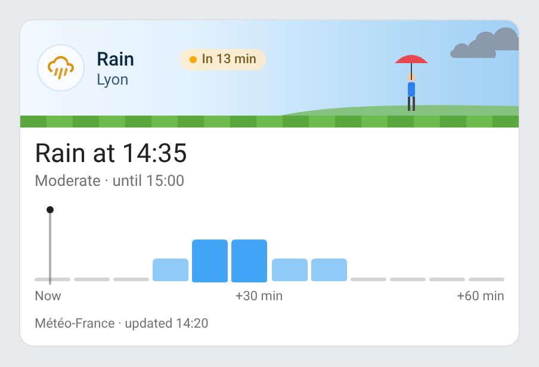 | 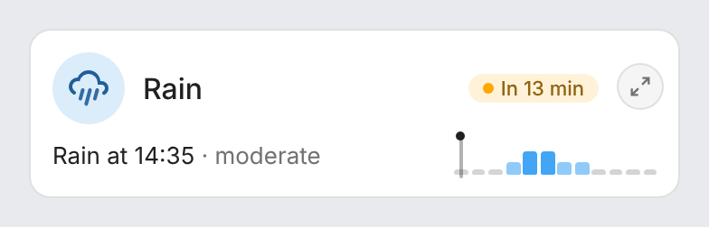 |

## Features

- Two cards: a full **Rain Card** (`custom:rain-card`) and a compact **Rain Mini Card** (`custom:rain-mini-card`)
- Headline for each state of the next hour: **Dry for the next hour**, **Rain at 14:35**, **Raining until about 15:20**, **Rain stops at 14:50**, with the intensity (**Light**, **Moderate**, **Heavy**) and the end time underneath
- Status pill on the right of the header: **Dry**, **In 15 min**, **Raining**, **Stops in 10 min** (and **Outdated**, **No data**, **Unavailable**)
- The **60-minute ribbon**: twelve 5-minute bars, taller and deeper blue as the rain gets heavier, a thin neutral bar when dry; the Météo-France 10-minute steps of the second half hour are spread over two bars each; axis labels Now / +30 / +60 min; a "now" marker moving along the ribbon as the minutes go by, the bars already past faded
- Animations (see [Animations](#animations)): the bars grow whenever the forecast changes, the coming shower glows, drops fall from the badge's cloud and onto the rainy bars while it rains
- **Out-of-date forecast** detected (no Météo-France update for 20 minutes, or a forecast whose hour is over): the ribbon turns grey and the pill reads **Outdated**
- Location as subtitle: the Météo-France city, the weather entity's name, or your own (`location`)
- Mini card: one line ("Rain at 14:35 · moderate"), a compact ribbon and the pill, with a detail button (top right) that unfolds the full card; a click anywhere outside the card folds it back, and so does leaving the page
- Click the headline or the pill to open the forecast entity (more-info dialog)
- Visual editor in the dashboard UI for both cards (no YAML needed)
- Sections view: the full card takes 12 columns by default and at least 6, the mini card 6; narrow widths get their own layout
- Times in your profile's 12 or 24-hour format and time zone (the server's when your profile asks for it)
- Light and dark mode, `prefers-reduced-motion`, English, French, German, Spanish, Italian, Dutch, European Portuguese, Polish, Serbian (Cyrillic and Latin), Romanian, Danish, Swedish, Bulgarian, Russian, Ukrainian, Hungarian, Slovak, Czech, Slovenian, Latvian and Greek
- Single file, no external dependency

## Supported integrations

| Integration | What the cards read |
|---|---|
|  [Météo-France](https://www.home-assistant.io/integrations/meteo_france/) (core, `meteo_france`) | The **Next rain** sensor (`sensor.*_next_rain`): its `1_hour_forecast` attribute (nine slots: every 5 minutes for the first half hour, then every 10 minutes), every label it uses (`Temps sec`, `Pluie faible`, `Pluie modérée`, `Pluie forte`, `Données indisponibles`, their English forms and the rain codes 1 to 4), its `forecast_time_ref` (start of the ribbon, out-of-date detection) and, when the minute forecast is missing, its state (time of the next rain). Rain forecast available for metropolitan France and some neighbouring areas |
| Any weather entity —  [Met.no](https://www.home-assistant.io/integrations/met/), OpenWeatherMap, AccuWeather, Pirate Weather, Open-Meteo, Buienradar, DWD, SMHI… | The hourly forecast (`weather.get_forecasts`, `type: hourly`): precipitation of each hour turned into an intensity, or its condition (`rainy`, `pouring`, `lightning-rainy`, `hail`, `snowy-rainy`) when it gives no precipitation. A finer forecast (15 or 30 minutes) is read at its own step. See [Weather entities](#weather-entities) |

## Prerequisites

Home Assistant 2024.8 or later, with the Météo-France integration configured for your city (the **Next rain** sensor is enabled by default), or any weather integration with an hourly forecast.

## Installation

### Via the Marketplace (recommended)

Click the button below to add the repository directly:

[](https://my.home-assistant.io/redirect/marketplace_repository/?owner=juju35&repository=ha-rain-card&category=plugin)

Then click **Install**, and reload your browser when the Marketplace asks you to.

Or manually:

1. Open **Settings → Marketplace → Add from link** (top right; this needs a GitHub account connected)
2. Add `https://github.com/juju35/ha-rain-card` — Type: **Dashboard**
3. Open **Rain Card** and click **Install**
4. Clear your browser cache and refresh

The Marketplace adds the resource `/local/community/ha-rain-card/rain-card.js` for you.

### Manual

1. Download `rain-card.js` and the `rain-card.i18n.*.js` translation files from the [latest release](https://github.com/juju35/ha-rain-card/releases/latest)
2. Copy them all to `/config/www/` (without the translation files, the cards show in English)
3. Go to **Settings → Dashboards → ⋮ → Resources** → Add resource:
   - URL: `/local/rain-card.js`
   - Type: **JavaScript Module**
4. Clear your browser cache and refresh

## Configuration

### Card types

| Card | Type |
|---|---|
| Rain Card | `custom:rain-card` |
| Rain Mini Card | `custom:rain-mini-card` |

### Visual editor

Edit a dashboard, click **Add card** and search for **Rain Card** or **Rain Mini Card**. With no entity chosen, the card finds the Météo-France Next rain sensor by itself (else the first weather entity with an hourly forecast); pick another one if you have several cities. The preview updates live, and options left at their default are kept out of the generated YAML.

### Minimal

```yaml
type: custom:rain-card
```

```yaml
type: custom:rain-mini-card
```

### Full options

```yaml
type: custom:rain-card
entity: sensor.meteo_france_rain_for_city_lyon_next_rain
name: Rain
location: Home
show_title: true
show_subtitle: true
show_details: true
show_ribbon: true
show_source: true
language: fr
```

```yaml
type: custom:rain-mini-card
entity: weather.forecast_home
show_details: true
zoom: true
```

### Options reference

| Option | Card | Default | Description |
|---|---|---|---|
| `entity` | both | Found automatically | Météo-France Next rain sensor, or a weather entity. By default the first Météo-France Next rain sensor (hidden ones skipped), else the first weather entity with an hourly forecast |
| `name` | both | `Rain` | Card title |
| `location` | both | From the forecast | Subtitle: the Météo-France city, else the weather entity's name, else the location name of Home Assistant (full card) |
| `show_title` | both | `true` | Show the title in the header |
| `show_subtitle` | both | `true` | Show the location under the title (full card) |
| `show_details` | both | `true` | Show the intensity and end time under the headline (the intensity after the line on the mini card) |
| `show_ribbon` | both | `true` | Show the 60-minute ribbon |
| `show_source` | both | `true` | Show the source and the time of the forecast under the ribbon (full card) |
| `zoom` | mini | `true` | Detail button at the top right of the mini card: it shows the full card (with the same options, so `show_source` or `location` can be set on the mini card too, in YAML or in its visual editor) and switches back; a click outside the card also brings the compact view back. `false` removes the button |
| `language` | both | Auto | Force language: `en`, `fr`, `de`, `es`, `it`, `nl`, `pt`, `pl`, `sr`, `sr-Latn`, `ro`, `da`, `sv`, `bg`, `ru`, `uk`, `hu`, `sk`, `cs`, `sl`, `lv` or `el` (auto-detects from HA settings) |
| `colors` | both | — | Override the ribbon bar colors by intensity. An object with `light` (level 1), `moderate` (level 2), `heavy` (level 3) and/or `crit` (the alert tint). Each value is a CSS color (hex, `rgb(…)`, `var(…)`, a named color). Omitted levels keep the default blue shades |

### Custom bar colors

```yaml
type: custom:rain-card
colors:
  light: "#fdd835"    # weak rain → yellow
  moderate: "#fb8c00" # moderate → orange
  heavy: "#e53935"    # heavy rain → red
```

## Screenshots

### Animations

Every animation honours `prefers-reduced-motion`. The bars grow from the bottom each time the forecast changes (at the start of each loop below), and the now marker moves along the ribbon, minute by minute.

Dry: thin neutral bars, the halo of the now marker breathing:

| Light | Dark |
|---|---|
| 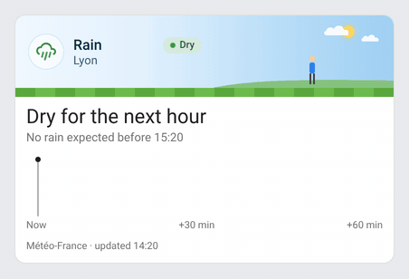 | 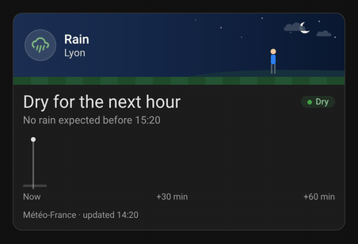 |

Rain soon: the bars of the coming shower glow:

| Light | Dark |
|---|---|
| 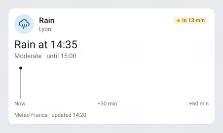 | 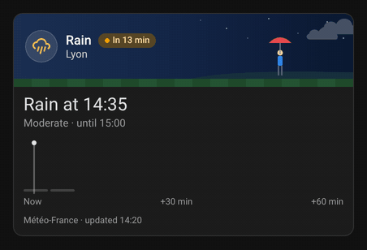 |

Raining all through the hour: drops fall from the cloud of the badge and onto every rainy bar:

| Dark | Light |
|---|---|
| 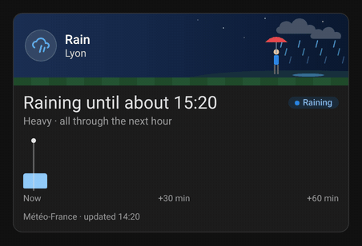 | 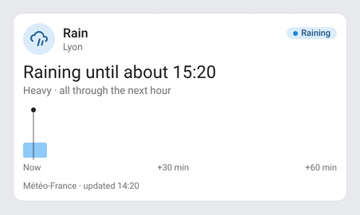 |

Rain stopping: the drops fall until the rain stops, the bars after it stay dry:

| Dark | Light |
|---|---|
| 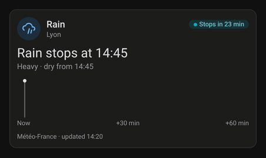 | 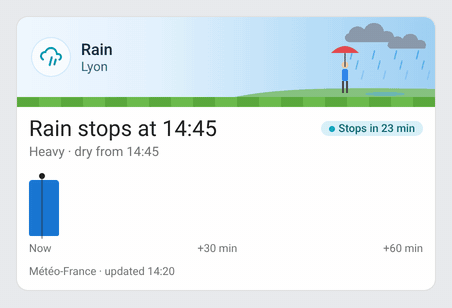 |

### Cards

The full card with Météo-France, rain coming in 13 minutes:

| Light | Dark |
|---|---|
|  | 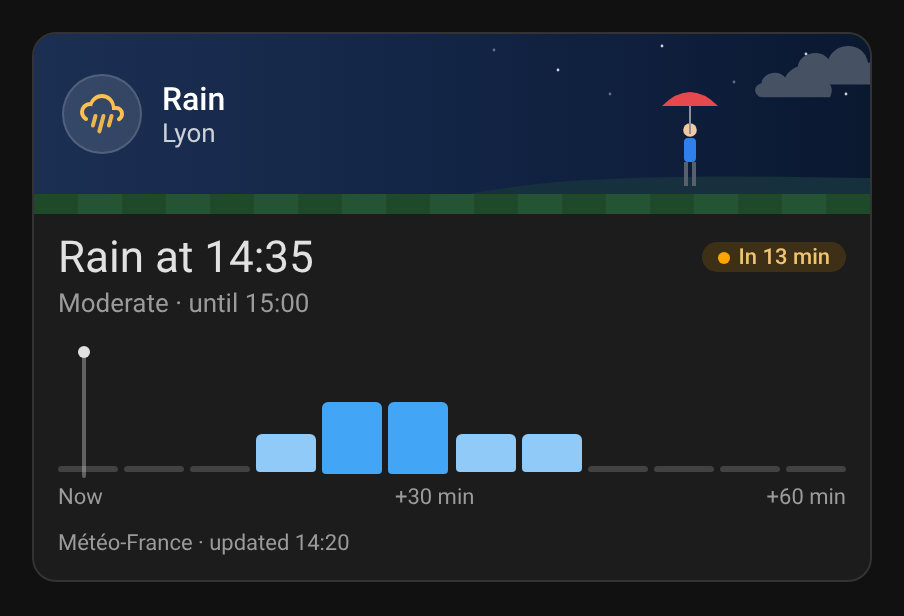 |

A weather entity (Met.no) instead, hour by hour:

| Dark | Light |
|---|---|
| 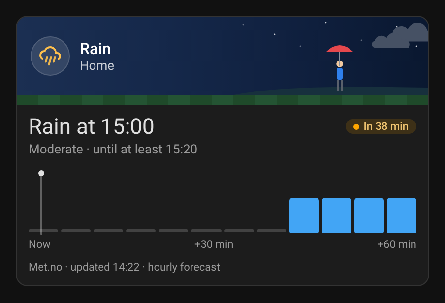 | 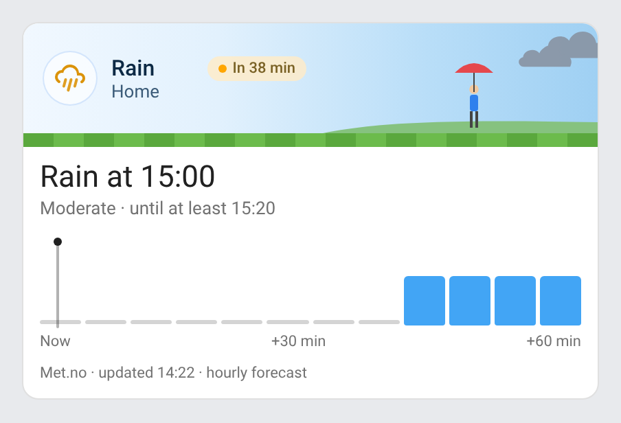 |

An out-of-date forecast (no Météo-France update for two hours):

| Dark | Light |
|---|---|
| 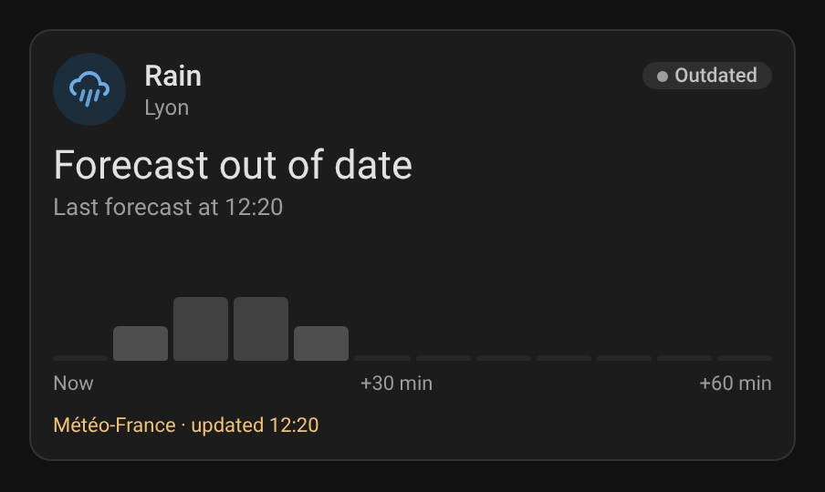 | 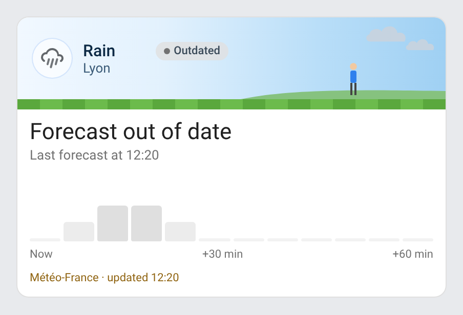 |

The mini card, and its detailed view after a click on the detail button:

| | Mini card | Detail view |
|---|---|---|
| Light |  | 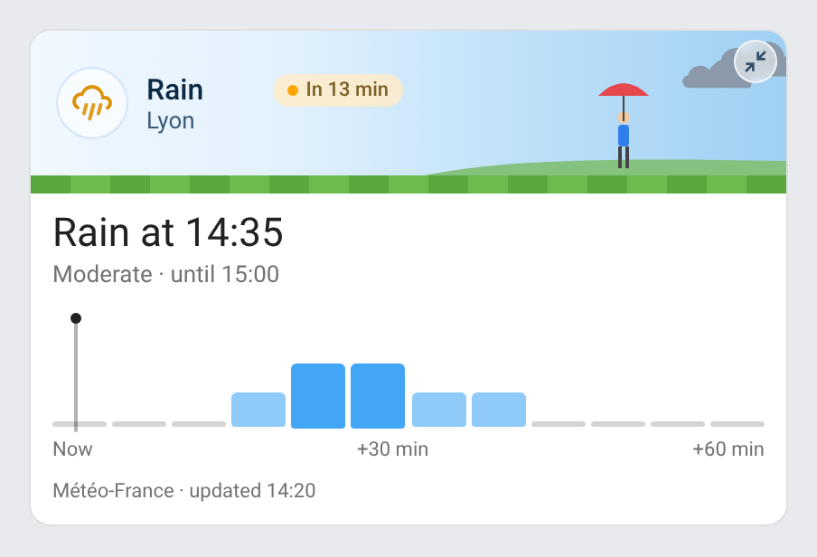 |
| Dark | 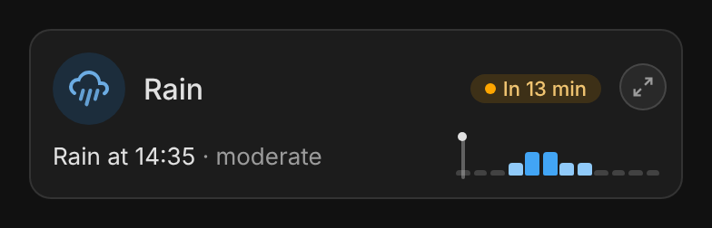 | 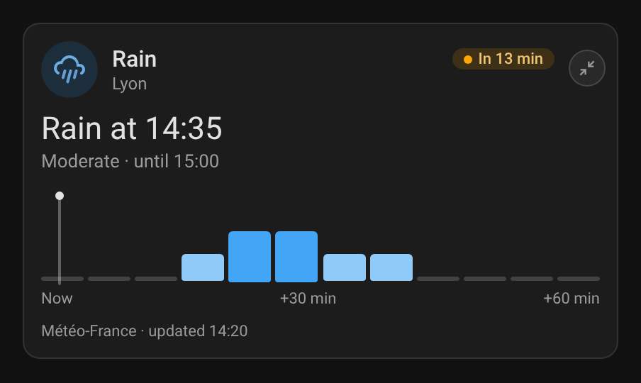 |

Narrow widths: the full card at 238 px (raining) and the mini card at 170 px (the ribbon under the line, the pill keeps its dot):

| | Full card | Mini card |
|---|---|---|
| Light | 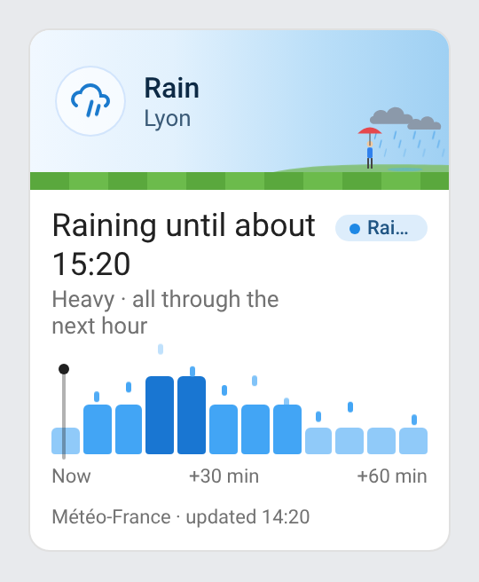 | 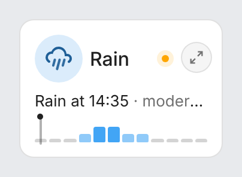 |
| Dark | 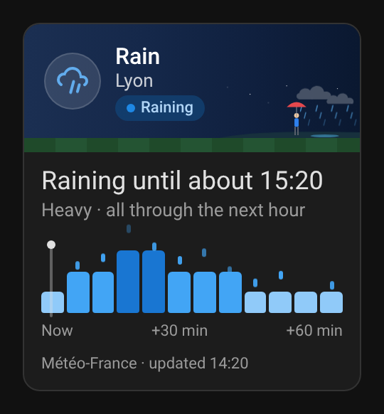 | 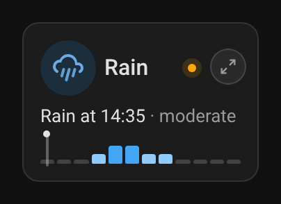 |

## How it works

### Météo-France

The Next rain sensor carries the rain forecast of the next hour in its `1_hour_forecast` attribute: `0 min` to `25 min` every 5 minutes, then `35 min`, `45 min` and `55 min`, each of those standing for 10 minutes (30–40, 40–50, 50–60). The card maps every slot onto the 5-minute bars it covers, counted from `forecast_time_ref`. Labels are read in French or English, and as rain codes: dry → thin bar, light / moderate / heavy rain → three heights and shades of blue, **Données indisponibles** → an empty outlined bar.

Météo-France refreshes this forecast every 5 minutes. When `forecast_time_ref` is more than 20 minutes old, or the hour it covers is over, the forecast is **out of date**: grey ribbon, **Outdated** pill and the time of the last forecast. An unavailable sensor reads **Unavailable**.

### Weather entities

A weather entity has no minute forecast: the card asks for its hourly forecast (`weather.get_forecasts`) when shown, again when the entity changes and every 15 minutes. Each bar takes the hour it falls in, the hour's precipitation read as a rate in mm/h — light from 0.1, moderate from 2.5, heavy from 7.6 mm/h — or, when the hour gives no precipitation, its condition. Since an hourly forecast does not say when in the hour the rain falls, a rainy hour reads as rain from its start: the headline is only as precise as the forecast, which the source line says (**hourly forecast**). Integrations that still put a `forecast` attribute on their entity are read from it. A forecast older than 3 hours that could not be fetched again is out of date.

### State of the next hour

From the bar the current time falls in: rain now and dry before the end of the hour → **Rain stops at …** (pill **Stops in N min**); rain until the end of the ribbon → **Raining until about …** (pill **Raining**); dry now and rain later → **Rain at …** (pill **In N min**), with the strongest intensity of that shower and its end; no rain at all → **Dry for the next hour**. Bars without data never end a shower: its end then reads "until at least".

## Development

```bash
npm install
npm run build        # bundles src/rain-card.js into dist/rain-card.js (translations split into dist/rain-card.i18n.*.js)
npm run check        # builds and checks the card (run in CI)
npm test             # unit tests (node --test)
npm run screenshots  # renders the cards (and one GIF per animated state, needs ffmpeg) with mock data into screenshots/
```

`dist/` is not committed: `npm run build` creates it locally, CI builds it on every push, and the release workflow attaches the built files to the release, which is where the Marketplace installs it from. The **Screenshots** workflow re-renders the captures on every pull request that touches the card and commits them to the pull request's branch when a pixel changed. The captures are rendered with the page clock frozen at 14:22 in the Europe/Paris time zone.

### Releasing

1. Bump `version` in `package.json` (and `package-lock.json` with `npm install`)
2. Add a `## <version>` section at the top of [CHANGELOG.md](https://github.com/juju35/ha-rain-card/blob/main/CHANGELOG.md)
3. Push to `main`: the **Release** workflow builds the card, creates the tag and the GitHub release with the changelog section as notes, and attaches `rain-card.js` and its translation files

## Translations

The cards auto-detect the language from your Home Assistant settings. Currently supported:

| Language | Code |
|---|---|
| English | `en` |
| Français | `fr` |
| Deutsch | `de` |
| Español | `es` |
| Italiano | `it` |
| Nederlands | `nl` |
| Português (European; also used for `pt-BR`) | `pt` |
| Polski | `pl` |
| Српски | `sr` |
| Srpski (latinica) | `sr-Latn` |
| Română | `ro` |
| Dansk | `da` |
| Svenska | `sv` |
| Български | `bg` |
| Русский | `ru` |
| Українська | `uk` |
| Magyar | `hu` |
| Slovenčina | `sk` |
| Čeština | `cs` |
| Slovenščina | `sl` |
| Latviešu | `lv` |
| Ελληνικά | `el` |

Contributions for additional languages are welcome!

## Credits

The Météo-France and Met.no logos come from the [Home Assistant brands](https://github.com/home-assistant/brands) repository. This project is not affiliated with Météo-France or the Norwegian Meteorological Institute.

## License

[MIT](https://github.com/juju35/ha-rain-card/blob/main/LICENSE)

## Support

If you find this project useful, you can support its development:

<a href="https://buymeacoffee.com/julienstep9"></a>
